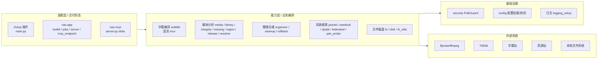
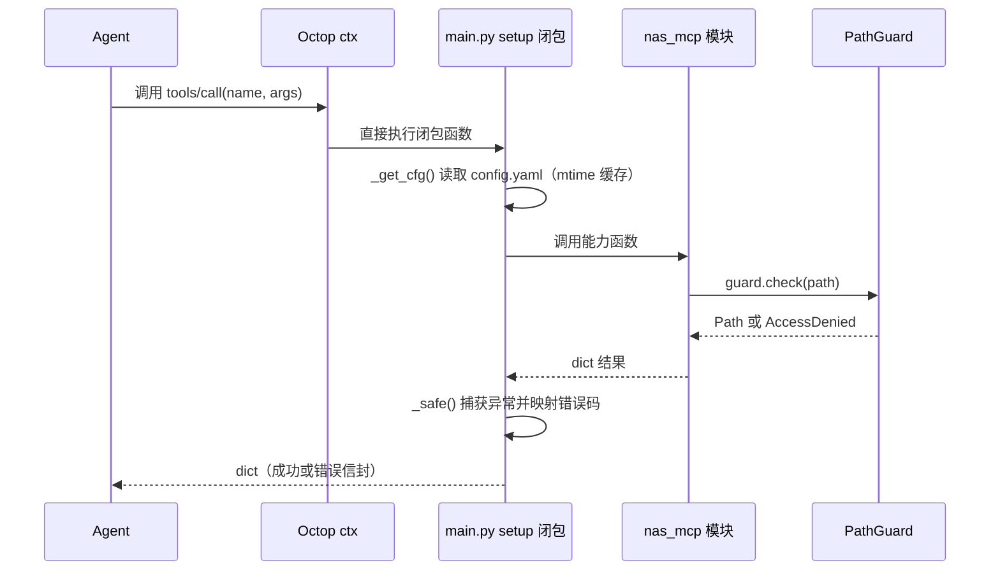
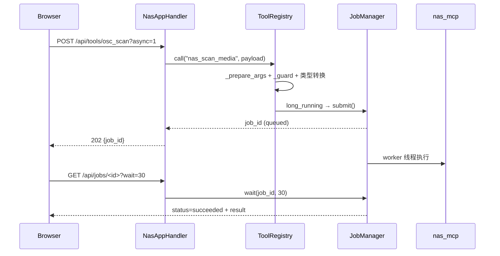

# 01 · 整体架构

## 1. 设计目标与非目标

**目标**

1. 把 NAS 上重复、易错的媒体运维动作（扫描、识别、查重、找字幕、混流、整理、清理）变成 Agent 可调用的结构化工具。
2. 让"能力"与"交付形态"解耦：同一套业务逻辑可在 Octop 插件、独立 Web 应用、stdio MCP 三种场景复用。
3. 用强制安全边界替代"自觉遵守"：路径白名单是硬约束，写操作需要显式开关。

**非目标（代码与 README 中明确的边界）**

- 不做下载器：Jackett / SeedHub / 网盘搜索只返回磁力或链接，绝不调用下载。
- 不做媒体服务器：不生成刮削元数据文件、不替代 Emby/Jellyfin。
- 不保证 100% 自动识别：识别不确定时返回 `unknown` / 低 `confidence`，交给用户决策。
- 删除类操作不可回滚（`cleanup`），混流（`mux`）也不支持回滚。

## 2. 分层架构



### 2.1 装配层的职责（三形态差异点）

装配层只做四件事，**不实现业务逻辑**：

1. **参数清洗**：把 Agent/表单传来的字符串（`"true"/"是"`、逗号或换行分隔的路径列表、JSON 编码的 list）转成内核需要的类型。
2. **配置加载**：解析 `config.yaml` 为冻结 dataclass，并按 mtime 热加载。
3. **错误封装**：捕获内核异常，转成统一错误信封（`ConfigError → not_configured`、`AccessDenied → access_denied` 等）。
4. **注册/暴露**：Octop 用 `ctx.tool()`，nas-app 用 `ToolRegistry.tool()`，nas-mcp 用 `@mcp.tool()`。

三种装配层的具体差异：

| 维度 | Octop 插件 | nas-app | nas-mcp |
| --- | --- | --- | --- |
| 入口 | `main.py: setup(ctx)` | `nas_app/__main__.py: main()` | `nas_mcp/__main__.py` |
| 配置来源 | 插件目录 `config.yaml` + 表单注入 | `<data>/config.yaml`，Web UI 可改 | `--config` 指定 |
| 工具注册数 | 29 | 28（MCP 端点 +2 任务工具 = 30） | 23 |
| 长任务 | 无任务系统，同步执行 | `JobManager` 线程池 + HTTP 轮询 | 无，靠客户端超时 |
| 写配置 | `nas_save_config` 行级写回 | `PUT /api/config` | 不暴露 |
| 传输入口 | 进程内函数调用 | HTTP :8669 + MCP :8670 | stdio |

### 2.2 能力层

能力层按领域拆成 6 组，彼此尽量单向依赖（详见 [02-modules.md](./02-modules.md)）：

- **文件与磁盘**：`fs` 负责目录遍历/搜索，`disk` 负责按设备去重的空间统计，`fs_utils` 提供统一的记录结构、跳过匹配、权限错误收集。
- **媒体分析**：`media` 做 ffprobe 探测与扫描，`release` 解析发布名，`resolver` 走 TMDB 识别，`region` 判国产，`library` / `integrity` / `missing` 做批量体检。
- **字幕**：`subhd` / `opensubtitles` / `shooter` 是站点适配器，`subtitle` 做多站点编排，`mux` 做混流。
- **资源搜索**：`jackett`（PT 索引）、`seedhub`（磁力+网盘）、`dysbk`（网盘论坛）、`federated`（三路聚合）、`pan_probe`（网盘链接可用性探测）。
- **整理运维**：`organizer`（计划/执行/审计）、`cleanup`（垃圾清理）、`rollback`（按 `operation_id` 回滚）。
- **基础设施**：`security`（白名单）、`config`（schema + 校验）、`logging_setup`。

### 2.3 基础设施层

只有两个"硬"组件：

- **`security.PathGuard`**：所有文件路径进入内核后的第一道关卡。
- **`config.NasConfig`**：冻结 dataclass，加载时完成校验、路径 resolve、环境变量替换、密钥解析。

## 3. 目录结构

```
fn/
├── README.md                        # 三形态总览
├── nas-octop-plugin/                # 形态 A：Octop 进程内插件
│   ├── plugin.yaml                  # id: nas-media, version 0.19.0
│   ├── main.py                      # 装配层（~1700 行）：配置、表单、29 工具、写回
│   ├── config.example.yaml          # 完整配置模板
│   ├── requirements.txt             # PyYAML>=6.0, curl_cffi>=0.10
│   ├── nas_mcp/                     # 能力内核（27 个模块）
│   ├── tests/                       # 插件专项 + 阶段验收 + stubs
│   └── dist/                        # 打包产物
├── nas-app/                         # 形态 B：独立应用
│   ├── nas_app/
│   │   ├── __main__.py              # 启动：settings → logging → config → registry → jobs → HTTP/MCP
│   │   ├── settings.py              # 环境变量/参数解析，首次生成 config.yaml
│   │   ├── toolkit.py               # ToolRegistry：28 工具注册、参数准备、错误映射
│   │   ├── jobs.py                  # JobManager：线程池 + 任务持久化
│   │   ├── server.py                # 标准库 HTTP 服务 + REST API + 鉴权
│   │   ├── mcp_endpoint.py          # FastMCP Streamable HTTP（:8670）
│   │   └── web/                     # 前端 Web UI
│   ├── nas_mcp/                     # 能力内核（与插件完全同源，27 个模块）
│   ├── packaging/fnos/              # 飞牛 .fpk 打包脚本、manifest、向导、生命周期脚本
│   ├── scripts/                     # 部署与运维辅助脚本
│   ├── tests/                       # settings/toolkit/jobs/server/mcp/fpk
│   ├── Dockerfile
│   └── docker-compose.yml
└── nas-mcp/                         # 形态 C：stdio MCP
    ├── src/nas_mcp/                 # 核心模块（与插件完全同步，27 个模块；server.py 注册 23 工具）
    ├── tests/                       # smoke/core sync/multisite/mux + stubs
    ├── pyproject.toml               # version 0.19.0, mcp>=2.3.0
    └── config.example.yaml
```

## 4. 调用链

### 4.1 Octop 插件：Agent 调用一次工具



注意：`main.py` 中的工具函数是 `setup()` 内的闭包，配置通过 `_get_cfg()` 在**每次调用时**重新取，因此改配置无需重启插件。

### 4.2 nas-app：长任务走 HTTP



同步工具（`risk=read` 且非 `long_running`）直接在同一请求内返回；只有标记 `long_running=True` 的工具进入线程池。

### 4.3 nas-app MCP 端点：长任务转异步

`mcp_endpoint.py` 对 `long_running` 工具先 `jobs.submit()`，然后**最多等待 240 秒**（`LONG_RUNNING_WAIT_SECONDS`）。超时未完成则返回 `status: queued/running` + `job_id`，让 MCP 客户端改用 `nas_job_status` 继续轮询。

### 4.4 nas-mcp：stdio 请求

`__main__.py` 解析 `--config` → 构建 `NasConfig` → `server.create_server()` → `mcp.run()`。工具通过 `@mcp.tool()` 直接注册，异常由 `_safe_tool` 包装。

## 5. 写操作分级与门控

这是整个项目最重要的安全设计。

| 级别 | 含义 | 示例工具 | 门控 |
| --- | --- | --- | --- |
| **只读** | 不改变文件系统 | 扫描、画质分析、搜索、`find_media` | 仅需路径在白名单内 |
| **L1** | 只生成计划，不执行 | `organize_media(dry_run=true)` | 只读即可 |
| **L2** | 执行移动/重命名 | `organize_media(dry_run=false)` | `enable_organize=true` + 白名单 |
| **L3** | 删除文件 | `organize_media(mode="all")` 中的删除动作、`media_cleanup` | `enable_organize` + `enable_delete` + 五重门 |
| **写盘** | 新增文件 | `subhd_download`、`media_fill_subtitles`、`media_mux_subtitles` | 站点启用 + `enable_write=true` + 白名单 |
| **回滚** | 撤销历史操作 | `media_rollback` | `enable_organize` + 有效 `operation_id` |

补充规则：

- `enable_delete` **不能**通过 `nas_save_config` 修改（显式拒绝，要求管理员直接编辑 `config.yaml`）。
- `media_cleanup` 默认 `dry_run=True`，真删必须显式传 `dry_run=false`，且永久删除不可回滚。
- `organize_media` 的 `identical` / `duplicate` 判定需要 `enable_delete` 才会真删，否则计划中标记为 `blocked`。

## 6. 配置热加载

| 形态 | 机制 | 生效时机 |
| --- | --- | --- |
| Octop 插件 | `_get_cfg()` 比较 `config.yaml` 的 `mtime`，变化则重新 `load_config` | 下次工具调用 |
| nas-app | `ToolRegistry.get_config()` 每次调用 `stat` 配置，`mtime` 变化则 `load_config`；`PUT /api/config` 写盘后立即生效 | 下次调用（无需重启） |
| nas-mcp | 启动时加载一次 | 需重启进程 |

热加载失败（YAML 语法错误、白名单非法）时，插件会抛出 `ConfigError`，由 `_safe()` 映射为 `not_configured`，**不会**退回到旧配置继续执行写操作。

## 7. 内核同源与同步策略

三个目录各自带一份 `nas_mcp/`，不是运行时共享包：

| 位置 | 模块完整度 | 版本 | 说明 |
| --- | --- | --- | --- |
| `nas-octop-plugin/nas_mcp/` | 完整（27 模块） | 0.19.0 | 事实上的**主版本** |
| `nas-app/nas_mcp/` | 完整（27 模块） | 0.19.0 | 与插件同源，使用 `scripts/sync_core.py` 严格同步 |
| `nas-mcp/src/nas_mcp/` | 完整（27 模块） | 0.19.0 | 与插件同源同步，`server.py` 装配层注册 23 个核心工具 |

因此：

- 三端核心模块已完全同源同步（27 个模块，v0.19.0）。
- 修改内核时，运行 `python scripts/sync_core.py` 即可一键自动同步至 `nas-app` 与 `nas-mcp`。

## 8. 进程与并发模型

| 形态 | 进程 | 并发 |
| --- | --- | --- |
| 插件 | 寄宿在 Octop 进程内 | 由宿主决定；插件自身无锁，依赖内核的进程级缓存（如 `resolver` 缓存、Jackett 熔断全局状态） |
| nas-app | 1 个 HTTP 主进程 + 1 个 MCP 监听线程 + `JobManager` 2 个工作线程 | 任务队列；同一时刻最多 2 个长任务并行 |
| nas-mcp | 1 个 stdio 进程 | 串行处理请求 |

`JobManager` 的任务持久化到 `<data>/jobs/<job_id>.json`，进程重启后 `_load_recent()` 会把最近任务重新载入内存（只用于展示，不恢复执行）。

## 9. 关键设计决策速查

| 决策 | 原因 |
| --- | --- |
| 白名单 + 排除目录，排除优先 | 网盘/USB 挂载点常位于媒体根之下，必须在白名单内也能被排除 |
| 所有工具返回 dict 而非抛异常 | Agent 需要结构化错误码做决策（换路线 / 重试 / 提示用户） |
| 字幕多站点串行 + 提前停止 | 避免无谓请求，同时保证评分基准一致 |
| Jackett 用绝对 deadline 而非逐请求超时 | 逐请求超时会被重试链叠乘，最终被上层 harness 掐断 |
| 熔断器 | 上游已宕机时继续重试只会把整次调用拖死 |
| 整理先出计划再执行 | 用户/AI 可以先审阅 `plan[]`，`dry_run` 默认开启 |
| 审计 JSONL + `operation_id` | 回滚需要可定位的操作记录，且不能靠"猜"恢复 |
| 混流用临时文件 + 二次 ffprobe 校验 + 原子替换 | ffmpeg 写坏原文件不可接受 |
| 首次启动生成 `chmod 600` 配置 | 配置里有 API Key / 密码 |
