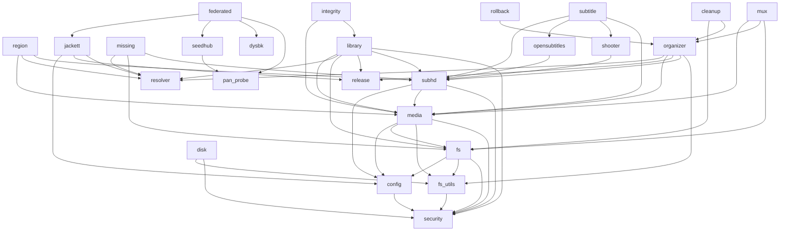

# 02 · 模块职责与依赖

本章按"装配层 → 能力层 → 基础设施"逐层说明每个模块做什么、对外暴露什么、依赖谁。

## 1. 模块总表

### 1.1 装配层

| 文件 | 职责 | 关键符号 |
| --- | --- | --- |
| [nas-octop-plugin/main.py](../../nas-octop-plugin/main.py) | Octop 插件装配：sys.path 注入、配置加载与热更新、表单字段定义、29 个工具闭包、`nas_save_config` 行级 YAML 写回 | `_get_cfg`、`_safe`、`_json`、`_injected_config`、`_patch_config_text`、`setup` |
| [nas-app/nas_app/settings.py](../../nas-app/nas_app/settings.py) | 环境变量/命令行解析，首次启动生成 `config.yaml`（`chmod 600`） | `AppSettings`、`build_settings`、`ensure_config` |
| [nas-app/nas_app/toolkit.py](../../nas-app/nas_app/toolkit.py) | 工具注册表：从函数签名+docstring 生成参数 schema，做类型转换、门控、错误信封 | `ToolSpec`、`ToolRegistry`、`_prepare_args`、`_normalize_error_envelope` |
| [nas-app/nas_app/jobs.py](../../nas-app/nas_app/jobs.py) | 长任务线程池与持久化 | `Job`、`JobManager` |
| [nas-app/nas_app/server.py](../../nas-app/nas_app/server.py) | 标准库 HTTP 服务、REST API、Cookie/Bearer 鉴权、CSRF | `NasHTTPServer`、`NasAppHandler`、`serve` |
| [nas-app/nas_app/mcp_endpoint.py](../../nas-app/nas_app/mcp_endpoint.py) | FastMCP Streamable HTTP 端点，长任务 240s 后转队列 | `McpEndpoint`、`LONG_RUNNING_WAIT_SECONDS` |
| [nas-mcp/src/nas_mcp/server.py](../../nas-mcp/src/nas_mcp/server.py) | stdio MCP 装配，注册 23 个工具 | `create_server`、`_safe_tool` |
| [nas-mcp/src/nas_mcp/__main__.py](../../nas-mcp/src/nas_mcp/__main__.py) | stdio 入口：解析 `--config`、初始化日志、运行 server | `main` |

### 1.2 能力层

| 模块 | 职责 | 关键符号 |
| --- | --- | --- |
| [security.py](../../nas-octop-plugin/nas_mcp/security.py) | 路径安全：白名单/排除目录、glob 匹配、`PathGuard` | `PathGuard`、`resolve_path`、`matches_pattern`、`expand_roots`、`AccessDenied`、`InvalidArguments` |
| [config.py](../../nas-octop-plugin/nas_mcp/config.py) | 配置 schema（冻结 dataclass）、校验、环境变量替换、预检 | `NasConfig`、`Limits`、`MediaConfig`、`OrganizerConfig`、`CleanupConfig`、`JackettConfig`、`SubhdConfig`、`load_config`、`preflight_check`、`ConfigError` |
| [fs_utils.py](../../nas-octop-plugin/nas_mcp/fs_utils.py) | 文件记录构建、跳过匹配、遍历、权限错误收集 | `make_record`、`iter_tree`、`make_skip_matcher`、`ErrorSink`、`mark_incomplete`、`media_category`、`human_size`、`normalize_list_arg` |
| [fs.py](../../nas-octop-plugin/nas_mcp/fs.py) | 目录列表与文件搜索（分页、截断标记） | `list_directory`、`find_files`、`_flat_records`、`_walk_records` |
| [disk.py](../../nas-octop-plugin/nas_mcp/disk.py) | 按 `st_dev` 去重的磁盘容量统计 | `disk_usage` |
| [media.py](../../nas-octop-plugin/nas_mcp/media.py) | ffprobe 探测、扫描、字幕状态判断 | `probe_video`、`scan_media`、`check_subtitle`、`find_external_subtitles`、`classify_media`、`ProbeError` |
| [release.py](../../nas-octop-plugin/nas_mcp/release.py) | 发布名解析与质量评分 | `ReleaseInfo`、`parse_release`、`quality_score_from_dimensions`、`bitrate_tiebreaker` |
| [resolver.py](../../nas-octop-plugin/nas_mcp/resolver.py) | TMDB 片名解析（中英映射、类型推断、进程级缓存） | `resolve`、`infer_media_type`、`ResolverError` |
| [region.py](../../nas-octop-plugin/nas_mcp/region.py) | 国产/非国产判定，带证据与置信度 | `classify` |
| [library.py](../../nas-octop-plugin/nas_mcp/library.py) | 画质分析、查重、媒体库体检 | `quality_analyze`、`duplicate_detect`、`audit`、`assess_file`、`_collect_targets` |
| [integrity.py](../../nas-octop-plugin/nas_mcp/integrity.py) | 文件完整性检查（basic/deep） | `integrity_check`、`assess_integrity` |
| [missing.py](../../nas-octop-plugin/nas_mcp/missing.py) | 以 TMDB 集数为基线检测缺集 | `media_missing_episodes`、`_scan_local_episodes` |
| [subhd.py](../../nas-octop-plugin/nas_mcp/subhd.py) | SubHD 站点适配 + 候选评分 + 归档处理 + 编码转换 | `SubhdClient`、`SubtitleCandidate`、`VideoQuery`、`parse_video_filename`、`score_candidate`、`search_subtitles`、`download_subtitle`、`convert_to_utf8` |
| [opensubtitles.py](../../nas-octop-plugin/nas_mcp/opensubtitles.py) | OpenSubtitles REST API 适配 | `search`、`fetch`、`OpensubtitlesError` |
| [shooter.py](../../nas-octop-plugin/nas_mcp/shooter.py) | assrt.net（射手网）API 适配 | `search`、`fetch`、`ShooterError` |
| [subtitle.py](../../nas-octop-plugin/nas_mcp/subtitle.py) | 多站点字幕编排：串行搜索、统一评分、提前停止、下载 failover、批量补字幕 | `search_subtitles`、`download_subtitle`、`fill_missing_subtitles`、`SubtitleError` |
| [mux.py](../../nas-octop-plugin/nas_mcp/mux.py) | 外挂字幕混流（双轨/单轨、原子替换、审计） | 混流计划与执行、`is_chinese_sub_candidate` |
| [organizer.py](../../nas-octop-plugin/nas_mcp/organizer.py) | 媒体整理：目录发现、实体解析、冲突仲裁、计划、执行、审计 | `plan_session`、`execute_plan`、`find_media`、`read_audit_records`、`new_operation_id` |
| [cleanup.py](../../nas-octop-plugin/nas_mcp/cleanup.py) | 垃圾清理：分类、五重门、证据、永久删除 | `cleanup`、`_evaluate` |
| [rollback.py](../../nas-octop-plugin/nas_mcp/rollback.py) | 按 `operation_id` 回滚整理动作（不处理删除类） | `rollback` |
| [jackett.py](../../nas-octop-plugin/nas_mcp/jackett.py) | Jackett 搜索：关键词扩展、deadline 预算、重试、熔断、去重排序、磁力补全 | `JackettClient`、`search`、`JackettResult`、`JackettError`、`generate_queries` |
| [seedhub.py](../../nas-octop-plugin/nas_mcp/seedhub.py) | SeedHub 搜索/磁力/网盘链接（curl_cffi 过 CF） | `search`、`magnets`、`pans` |
| [dysbk.py](../../nas-octop-plugin/nas_mcp/dysbk.py) | 网盘资源分享社（Flarum）搜索与直链 | `search`、`links` |
| [pan_probe.py](../../nas-octop-plugin/nas_mcp/pan_probe.py) | 网盘链接可用性探测（夸克透视、虚标校验） | `probe_pan_url` |
| [federated.py](../../nas-octop-plugin/nas_mcp/federated.py) | 三路并行聚合搜索与合并排序 | `search`、`_merge`、`_rank` |
| [logging_setup.py](../../nas-mcp/src/nas_mcp/logging_setup.py) | 日志初始化（仅 nas-mcp 使用） | `setup_logging` |

## 2. 模块依赖图

箭头方向 = "import 依赖"。



要点：

- `security` 与 `config` 是**无环根部**，`config` 反过来依赖 `security` 做路径规范化/校验。
- `subhd` 是意外的重要枢纽：它导出的 `SubtitleCandidate` / `VideoQuery` / `parse_video_filename` 被 `library`、`region`、`missing`、`organizer`、`mux` 复用。**改动这些数据结构会波及 6 个模块**。
- `organizer` 被 `cleanup`、`rollback`、`mux` 反向依赖（审计写入、`operation_id`、`_move_file`），因此 `organizer` 是运维域的核心。
- `federated` 只做聚合，不反向被依赖。

## 3. 关键函数索引

### 3.1 安全与配置

```python
# security.py
is_pattern(p: str) -> bool                      # 是否含 glob 元字符
matches_pattern(path: Path, pattern: str) -> bool  # 匹配自身或祖先
expand_roots(paths) -> list[str]                # 展开 glob 为具体根
is_within(child: Path, parent: Path) -> bool
resolve_path(p: str) -> Path                    # expanduser + resolve
class PathGuard:
    def __init__(self, allowed: tuple[str, ...], excluded: tuple[str, ...])
    def check(self, raw: str) -> Path           # 校验后返回 resolved Path
    def is_allowed_resolved(self, path: Path) -> bool

# config.py
load_config(path: str | Path) -> NasConfig      # 解析 + 校验 + 密钥解析
preflight_check(cfg) -> list[str]               # 启动前权限自检，返回警告列表（空 = 全通过）
```

`PathGuard.check()` 的判定顺序：

1. 路径必须是绝对路径或可 resolve 的相对路径；
2. 命中 `exclude_paths`（字面量或 glob，匹配自身或祖先）→ `AccessDenied`；
3. 命中 `allowed_paths` 任一模式 → 通过；
4. 否则 `AccessDenied`。

### 3.2 文件与媒体

```python
# fs.py
list_directory(guard, limits, *, path="", recursive=False, limit=0, offset=0) -> dict
find_files(guard, limits, *, keyword="", category="", extensions=None, root="",
           recursive=True, limit=0, offset=0) -> dict

# media.py
probe_video(path: Path, mcfg: MediaConfig) -> dict     # ffprobe JSON → 结构化
scan_media(guard, cfg, *, path="", recursive=True, probe=True,
           missing_subtitle_only=False, media_type="", limit=0, offset=0) -> dict
check_subtitle(guard, cfg, path) -> dict
classify_media(...) -> str                             # movie / tv / unknown

# library.py
quality_analyze(...) -> dict
duplicate_detect(...) -> dict
audit(...) -> dict
assess_file(path, ...) -> dict                          # 单文件质量评估

# integrity.py
integrity_check(guard, cfg, *, path="", paths=None, mode="basic",
                limit=100, offset=0) -> dict

# missing.py
media_missing_episodes(guard, cfg, *, title="", season=None, path="",
                       paths=None, limit=100, offset=0) -> dict
```

### 3.3 字幕与混流

```python
# subhd.py
parse_video_filename(name: str) -> VideoQuery
score_candidate(c: SubtitleCandidate, q: VideoQuery, *, release_hint=None) -> float
search_subtitles(guard, cfg_subhd, *, video_path="", keyword="", tmdb_cfg=None) -> dict
download_subtitle(...) -> dict
convert_to_utf8(data: bytes) -> tuple[bytes, str]      # 内容 + 推测编码

# subtitle.py（编排层）
search_subtitles(guard, cfg: NasConfig, *, video_path="", keyword="",
                 tmdb_cfg=None) -> dict
download_subtitle(guard, cfg, *, video_path, sid, lang="zh-Hans",
                  ext="srt", overwrite=False) -> dict
fill_missing_subtitles(guard, cfg, *, path="", dry_run=True,
                       lang="zh-Hans", ext="srt") -> dict

# mux.py
# 对外仅通过工具 media_mux_subtitles 暴露；
# 内部：计划 → ffmpeg 混流 → 临时文件 → ffprobe 校验 → 原子替换
```

### 3.4 资源搜索

```python
# jackett.py
generate_queries(query, year=0, media_type="", max_queries=4) -> list[str]
search(cfg: JackettConfig, tmdb_cfg: TmdbConfig | None, *, query,
       year=0, media_type="", limit=0) -> dict
reset_circuit() -> None                                # 测试用
_circuit_state() -> dict

# seedhub.py
search(cfg, keyword) -> dict
magnets(cfg, movie_id, limit=0, offset=0) -> dict
pans(cfg, movie_id, limit=0, offset=0) -> dict

# dysbk.py
search(cfg, query, limit=20) -> dict
links(cfg, discussion_id) -> dict

# federated.py
search(cfg: NasConfig, query: str) -> dict             # 三路并行，单路失败不影响
```

### 3.5 整理运维

```python
# organizer.py
plan_session(guard, cfg, *, path, mode="all", dry_run=True,
             preexisting_empty_scope="library_root") -> dict
execute_plan(guard, cfg, plan, *, mode, operation_id=None) -> dict
find_media(guard, cfg, *, title, season=0, episode=0) -> dict
read_audit_records(path: str) -> list[dict]
new_operation_id() -> str
_audit(...) -> None
_move_file(...) -> None

# cleanup.py
cleanup(guard, cfg, *, path="", files=None, dry_run=True,
        limit=100, offset=0) -> dict

# rollback.py
rollback(guard, cfg, *, operation_id: str, dry_run=True) -> dict
```

`plan_session` 返回的计划中，每个动作形如：

```json
{
  "action": "move | rename_dir | identical | duplicate | blocked | cleanup_dir | skip",
  "source": "/abs/path",
  "target": "/abs/path",
  "reason": "season_mismatch / duplicate_keeper / ...",
  "risk": "low | medium | high"
}
```

`execute_plan` 在执行前做一次**全局写权限预检**（`os.access`），任一动作不可写则整体不执行；执行时逐动作写审计，`operation_id` 贯穿整次会话。

## 4. 外部依赖

| 依赖 | 用途 | 必需性 | 相关配置 |
| --- | --- | --- | --- |
| `ffprobe` | 视频流信息探测 | 媒体分析类工具必需 | `media.ffprobe_path` |
| `ffmpeg` | 字幕混流 | `media_mux_subtitles` 必需 | `media.ffmpeg_path` |
| `PyYAML` | 配置读写 | 必需 | `requirements.txt` |
| `curl_cffi` | SeedHub 过 Cloudflare | SeedHub 工具必需（懒加载） | `requirements.txt` |
| `mcp` | MCP 协议实现 | nas-app / nas-mcp 必需 | `pyproject.toml`（`mcp==1.28.1` / `>=2.3.0`） |
| TMDB API | 片名识别、类型、集数基线 | 可选 | `tmdb.enabled/api_key` |
| Jackett | PT 索引搜索 | 可选 | `jackett.enabled/url/api_key` |
| SubHD / OpenSubtitles / assrt | 字幕源 | 可选（至少一个） | `subhd/opensubtitles/shooter.enabled` |
| SeedHub / 网盘资源分享社 | 磁力/网盘资源 | 可选 | `seedhub.enabled` / `dysbk.enabled` |
| `shutil`（`disk_usage`） | 容量统计 | 内置 | — |

所有网络依赖失败都必须转成**结构化错误**，不得让工具崩溃：`ResolverError`、`JackettError`、`SubhdError`、`OpensubtitlesError`、`ShooterError`、`SubtitleError`。

## 5. 各模块的"坑位"提示

| 模块 | 注意点 |
| --- | --- |
| `security.py` | `matches_pattern` 同时匹配路径自身与祖先；写新匹配逻辑时不要改成只匹配自身，否则 `/vol1/1000` 白名单放不进子目录 |
| `config.py` | `_strict_bool` 拒绝字符串 `"false"`，只接受真正的 bool；`nas_save_config` 的 `_parse_bool_strict` 是另一套实现，两边不要混用 |
| `fs.py` | 结果里的 `truncated` / `scan_truncated` 表示"还有数据没返回"，客户端必须能区分"真的没有"和"没扫完" |
| `subhd.py` | 评分权重是跨站点统一基准，站点适配器内的 `score` 会被编排层覆盖为 0 后重算 |
| `subtitle.py` | `site_attempts` 里会出现伪站点 `"_stopped"`，统计时要过滤 |
| `jackett.py` | 模块级熔断状态是进程全局的，测试必须 `reset_circuit()` |
| `organizer.py` | 计划生成与执行分离；`execute_plan` 不做二次业务判断，只做安全预检 + 执行 |
| `cleanup.py` | 删除不可回滚；`dry_run` 默认 True 是刻意设计 |
| `rollback.py` | 只接受 `operation_id`，不接受任意路径；删除类动作不在支持范围 |
| `mux.py` | 临时文件 + 原子替换；失败时原文件必须保持可播放 |
