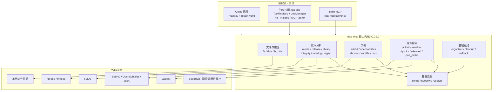

# NAS 媒体工具箱 · Code Wiki

> 面向开发者的代码级说明文档。目标：读完后能理解仓库的分层结构、模块职责、关键函数、依赖关系，并能把三种形态跑起来。

## 1. 这是什么

本仓库是一套**面向 NAS 的媒体运维工具集**，把"扫描媒体库 / 识别片名 / 画质分析 / 查重 / 找字幕 / 混流 / 整理 / 清理 / 回滚 / 找资源"这些操作封装成 MCP 工具，供 Agent 或 Web UI 调用。

核心设计约束：

- **默认只读**：所有写操作（落盘、移动、删除）都必须同时满足"配置开关 + 路径白名单"双重门控。
- **结构化返回**：所有工具返回 `dict`，失败统一为 `{"ok": false, "error": {...}}`，而不是抛裸异常给上层。
- **能力与装配分离**：同一份 `nas_mcp` 能力内核（`0.19.0`）被三种交付形态复用，差异只在装配层。

## 2. 三种交付形态

| 形态 | 目录 | 进程模型 | 工具数 | 入口 | 适用场景 |
| --- | --- | --- | --- | --- | --- |
| Octop 进程内插件 | [`nas-octop-plugin/`](../../nas-octop-plugin) | 宿主进程内 | **29**（28 业务 + `nas_save_config`） | [`main.py`](../../nas-octop-plugin/main.py) | 只用 Octop，要零额外进程 |
| 独立应用 | [`nas-app/`](../../nas-app) | 独立 HTTP 服务 | **28 业务**（MCP 端点另加 2 个任务工具，共 30） | [`__main__.py`](../../nas-app/nas_app/__main__.py) | 要 Web UI / 手机访问 / Docker / 飞牛商店 |
| stdio MCP 服务 | [`nas-mcp/`](../../nas-mcp) | 独立子进程（stdio） | **23**（覆盖主流媒体/字幕/搜索） | [`server.py`](../../nas-mcp/src/nas_mcp/server.py) | 客户端只支持 stdio |

关键事实：

- 三者共享同一份能力内核，`nas_mcp.__init__.__version__` 均为 `0.19.0`；核心 27 个模块均已通过 `scripts/sync_core.py` 严格同步。`nas-mcp` 的 `server.py` 注册了 23 个工具。
- 三者可以同时安装、各自独立配置，但**不要同时让多个形态写同一批媒体目录**（整理 / 清理 / 混流）。只读操作可以并行。
- 工具命名差异：多站点字幕工具在插件与 nas-app 叫 `subhd_search` / `subhd_download`，在 nas-mcp 叫 `subtitle_search` / `subtitle_download`。

## 3. 架构总览

一句话概括调用链：**装配层做参数清洗与错误封装 → 能力层做业务编排 → 基础设施做路径校验与配置 → 外部系统执行真实动作**。

## 4. 文档导航

| 文档 | 内容 |
| --- | --- |
| [01-architecture.md](./01-architecture.md) | 分层架构、目录结构、调用链、写操作分级、配置热加载、内核同源策略 |
| [02-modules.md](./02-modules.md) | 逐模块职责、模块依赖图、关键函数索引 |
| [03-api-reference.md](./03-api-reference.md) | 数据模型、异常体系、关键函数签名与返回结构 |
| [04-tools.md](./04-tools.md) | 三种形态的工具目录、参数、风险等级、典型工作流 |
| [05-config-and-security.md](./05-config-and-security.md) | 配置 schema、环境变量、路径白名单、门控矩阵、错误码、审计 |
| [06-run-and-deploy.md](./06-run-and-deploy.md) | 前置依赖、三种部署方式、端口/卷/健康检查、升级注意事项 |
| [07-testing-and-development.md](./07-testing-and-development.md) | 测试清单与运行方式、stub、新增工具流程、已知限制 |

## 5. 术语表

| 术语 | 含义 |
| --- | --- |
| **media_root** | 媒体搜索根目录，必须属于 `allowed_paths` 白名单 |
| **PathGuard** | 路径安全闸门对象，所有文件操作前必须过 `guard.check()` |
| **L1 / L2 / L3** | 整理的三级模式：L1 只出计划；L2 执行移动；L3 允许删除重复/垃圾 |
| **operation_id** | 一次整理/清理/混流会话的审计标识，回滚只接受它 |
| **五重门** | 清理删除的五项前置校验（白名单/开关/证据/活跃下载/特殊目录） |
| **switch_min_score** | 多站点字幕搜索的提前停止分数线，默认 `0.9` |
| **deadline** | Jackett 搜索的绝对时间预算（`time.monotonic()` 基准），默认 50s |
| **熔断器** | Jackett 连续失败 3 次后冷却 60s，避免耗尽上层超时 |
| **pack_hint** | 字幕候选是否像"整季包"的提示字段 |
| **failover** | 字幕下载失败时按 `site_order` 换站重搜重下 |
| **incomplete** | 结果因权限/预算/截断而不完整时的标记字段 |

## 6. 事实基准

本文档描述的是仓库当前代码状态：

- 内核版本：`nas_mcp.__version__ = "0.19.0"`
- 插件版本：`plugin.yaml version: 0.19.0`
- nas-app 版本：`nas_app.__version__ = "0.19.0"`
- nas-mcp 核心同步至 0.19.0，注册 23 个工具
- Python：插件与 nas-app 声明 `>=3.10`（代码使用 `X | None` 注解），nas-mcp 声明 `>=3.12`

若代码与文档冲突，以代码为准，并请更新对应章节。
